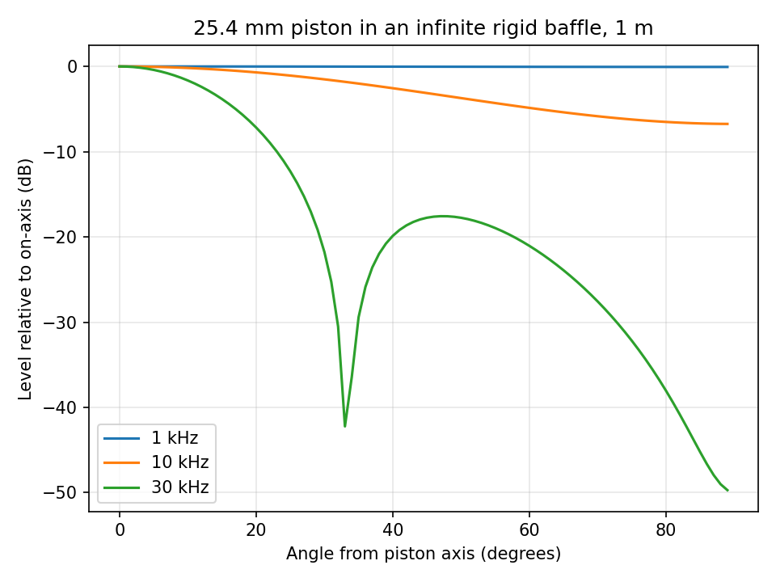
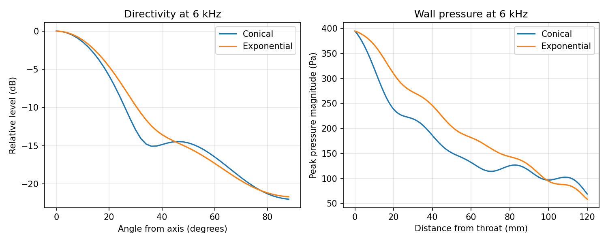

# Horn workflow coverage, 25 November 2026

Scope is AuSolveris on PR #7 and the loudspeaker workflows relevant to a front-loaded horn. The comparator is the [AKABAK product description](https://www.randteam.de/AKABAK3/AKABAK-Introduction.html). A 30 kHz horn is our design target. A matched AKABAK project or measured reference has yet to be run.

Each row has equal weight. Stages are 0% for no working implementation in this workflow, 25% for tested components, 50% for a runnable physical benchmark, 75% for a runnable horn example, and 100% for the example meeting agreed acceptance limits against an independent reference. These are management estimates. Separate OS-LEM releases earn credit here once the workflow can use them.

| Workflow | Stage | Evidence or missing deliverable |
|---|---:|---|
| Geometry input and meshing | 75% | A sampled axial profile generates the axisymmetric interior mesh. General CAD import is open. |
| Exterior 3D acoustics | 50% | Sphere benchmark. Horn exterior uses a baffled half-space aperture. General 3D horn radiation is open. |
| Observer pressure and directivity | 75% | Finite-distance horn polar sweep with radially varying aperture velocity. |
| Interior horn and mouth radiation | 75% | Rigid-wall FEM interior with a coupled annular radiation load. |
| Axisymmetric horn analysis | 75% | Runnable conical and exponential profile examples. |
| Driver network and acoustic feedback | 0% | Coupling to OS-LEM and a driven 1 V example needed. |
| End-user acoustic plots and export | 75% | CSV with impedance, complex pressure and absolute SPL. PNG with directivity and wall pressure. |

Mean stage score is 425/7 = 60.7%. Five rows now have a runnable round-horn example. Zero have reached independent horn validation. Electronics design, room acoustics, direct sound and other parts of AKABAK are outside this comparison.

## Numerical evidence

Run from the repository root with NumPy available:

```sh
OPENBLAS_NUM_THREADS=1 PYTHONPATH=src python examples/rigid_sphere_convergence.py
```

The unit-radius sound-hard sphere receives a 1 Pa plane wave along +x. Microphones are at twice the radius at 0°, 90° and 180° to the propagation direction. Relative L2 error compares complex scattered pressures against the existing analytical partial-wave solution. The dimensionless ka values below describe wavelength relative to radius.

| Panels | ka = 0.5 | ka = 1 | ka = 2 |
|---:|---:|---:|---:|
| 20 | 23.558% | 20.009% | 42.336% |
| 80 | 3.105% | 5.818% | 9.851% |
| 320 | 3.152% | 3.932% | 4.541% |
| 1,280 | 2.398% | 2.483% | 2.838% |

The benchmark solves a single-layer boundary density with the exterior Neumann jump, then integrates pressure at each microphone. Off-diagonal rows include edge- and vertex-adjacent panels. The corrected fixture projects every mesh vertex onto the requested sphere and derives normals from the triangular faces. Its geometry hashes change. Close parallel evaluation is checked separately against the static solid angle of a square.

## Prescribed-velocity radiator

A 25.4 mm diameter circular piston centred in an infinite rigid baffle radiates into the front half-space. The example uses 1 m/s peak uniform velocity, a 1 m microphone radius, air density 1.21 kg/m³ and sound speed 343 m/s. The Rayleigh integral uses the same outgoing-wave convention as the exterior sphere benchmark. It supplies an independent half-space source model for future horn work.

```sh
PYTHONPATH=src python examples/baffled_piston_polar.py --output-dir piston-results
```



The sweep exports 0° through 89° at 1, 10 and 30 kHz. Tests cover absolute complex on-axis pressure, independent off-axis disk integration in the near field, and signed far-field directivity including the first zero of the Bessel pattern. At 30 kHz the analytical far-field null lies at 33.30°. The finite-distance curve has a dip near that angle. The 1 m response relative to the axis is −3.82 dB at 15°, −21.79 dB at 30° and −17.75 dB at 45°.

## Round horn with prescribed throat velocity

From the repository root, install the dependencies and run the comparison.

```sh
python -m pip install -r requirements.txt
PYTHONPATH=src python examples/round_horn_comparison.py --output-dir horn-results
```

Both horns have a 25.4 mm throat diameter, 120 mm mouth diameter and 120 mm length. One radius grows linearly. The other grows exponentially and is sampled at 17 axial stations. The throat moves at 1 m/s peak. The model uses lossless air, rigid walls, and an infinite rigid baffle flush with the mouth. The sparse axisymmetric finite-element solve resolves axial and radial pressure variation. Each annular mouth face exchanges mean pressure and normal velocity with the half-space Rayleigh operator. Impedance is mean throat pressure divided by total inlet volume velocity, with the outgoing wave convention exp(-iωt).



| Flare at 6 kHz | Throat impedance (kPa s/m³) | On-axis SPL at 1 m | SPL at 30° at 1 m |
|---|---:|---:|---:|
| Conical | 809.9 − 134.6i | 114.57 dB | 101.66 dB |
| Exponential | 793.8 − 61.3i | 113.75 dB | 104.01 dB |

The example exports four frequencies and 45 angles per flare. Doubling nominal axial resolution from 96 to 192 and radial resolution from 16 to 32 at 6 kHz changed complex throat impedance by 1.02% (conical) and 0.70% (exponential). Relative L2 differences in complex microphone pressure were 2.71% and 2.32% respectively, normalized to the finer results. Differences were smaller at the other three frequencies. Tests compare a straight duct against its axial transfer relation, the disk load against the Bessel/Struve mean piston impedance, and inlet power against outlet power. Independent full-horn validation is pending.

The inherited mouth model is limited to ka ≤ 10, about 9.1 kHz for this 60 mm mouth radius. A 30 kHz calculation at this radius needs ka ≈ 33 and additional aperture, interior-mesh and physical-source validation.
